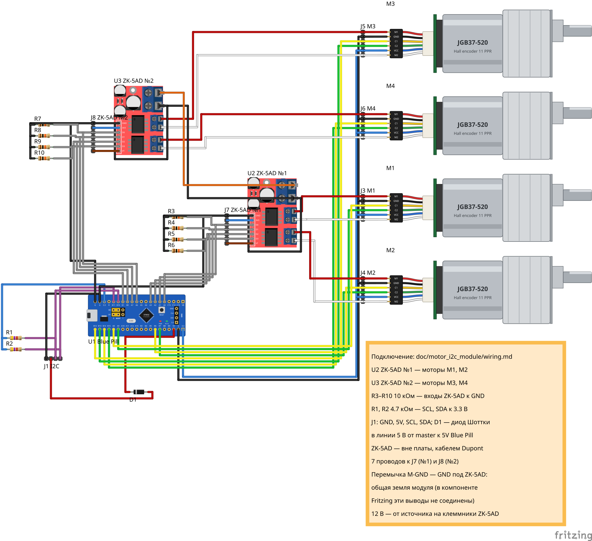
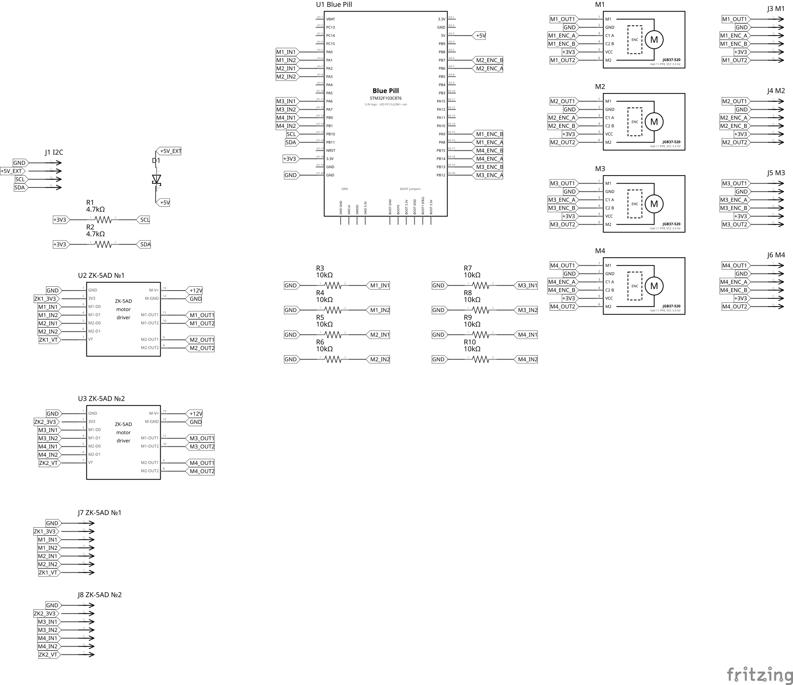
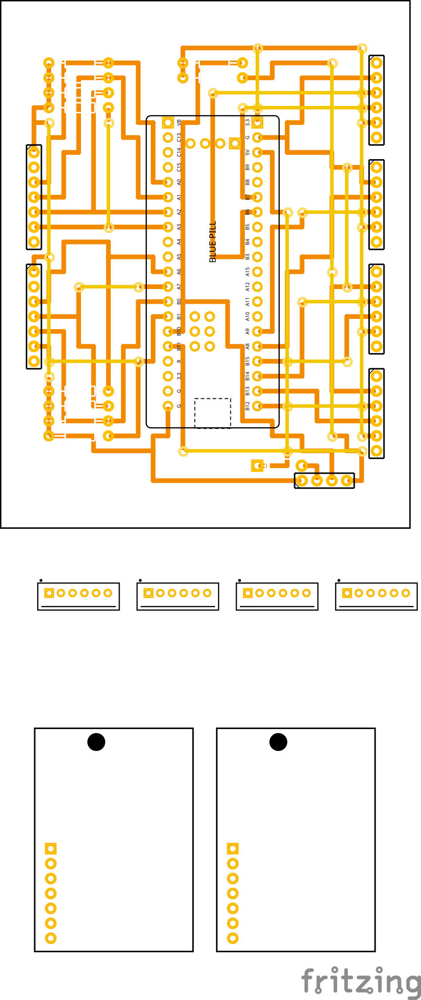

# Схема motor_i2c_module для Fritzing

Схема подключения из [wiring.md](../wiring.md) в виде проекта Fritzing.

| Файл | Что это |
|---|---|
| [motor_i2c_module.fzz](motor_i2c_module.fzz) | проект Fritzing 1.0.8 |
| [motor_i2c_module_breadboard.svg](motor_i2c_module_breadboard.svg) | вид «Макетная плата», экспорт Fritzing |
| [motor_i2c_module_schematic.svg](motor_i2c_module_schematic.svg) | вид «Схема», экспорт Fritzing |
| [motor_i2c_module_pcb.svg](motor_i2c_module_pcb.svg) | вид «Печатная плата» — разводка перфоплаты, экспорт Fritzing |
| [perfboard.md](perfboard.md) | монтажная карта перфоплаты: отверстия выводов, соединения снизу, перемычки |

## Как открыть

Fritzing 1.0.8 или новее: «Файл → Открыть» → `motor_i2c_module.fzz`.
Компоненты Blue Pill, ZK-5AD и JGB37-520 встроены в файл, отдельно ставить
`.fzpz` не нужно.

## Компоненты

| Обозначение | Компонент | Количество |
|---|---|---|
| U1 Blue Pill | STM32F103C8T6 Blue Pill (`STM32_Blue_Pill.fzpz`) | 1 |
| U2 ZK-5AD №1 | драйвер моторов 1, 2 (`motor-driver-ZK-5AD.fzpz`) — вне платы, на кабеле к J7 | 1 |
| U3 ZK-5AD №2 | драйвер моторов 3, 4 — вне платы, на кабеле к J8 | 1 |
| J7 ZK-5AD №1, J8 ZK-5AD №2 | штырьковые разъёмы 7 контактов, 2.54 мм, под кабель Dupont 1:1 к разъёму управления модуля: 1 — GND, 2 — 3V3, 3 — IN1, 4 — IN2, 5 — IN3, 6 — IN4, 7 — VT | 2 |
| M1…M4 | JGB37-520 с энкодером (`JGB37-520_Encoder_Motor.fzpz`) — вне платы, на кабеле | 4 |
| J3 M1 … J6 M4 | штырьковые разъёмы 6 контактов, 2.54 мм, под кабель мотора: 1 — M1 (обмотка), 2 — GND, 3 — C1, 4 — C2, 5 — VCC, 6 — M2 (обмотка) | 4 |
| J1 I2C | штырьковый разъём 4 контакта, 2.54 мм: 1 — GND, 2 — 5V, 3 — SCL, 4 — SDA | 1 |
| D1 | диод Шоттки 1N5817 (подойдёт 1N5819): анод — J1 контакт 2, катод — `5V` Blue Pill | 1 |
| R1, R2 | 4.7 кОм — подтяжки SCL и SDA к 3.3 В ([wiring.md](../wiring.md), раздел 7) | 2 |
| R3…R10 | 10 кОм — подтяжки входов ZK-5AD к GND ([wiring.md](../wiring.md), раздел 6) | 8 |

Подтяжки R1–R10 в wiring.md рекомендованы, но не обязательны. Если на шине
I2C уже есть подтяжки (например, на плате master), R1 и R2 не ставьте.

## Виды

- **Макетная плата.** Цвета проводов как в [hardware.md](../hardware.md):
  обмотки красный (M1) и белый (M2), энкодер жёлтый (C1) и зелёный (C2),
  питание энкодеров синий, земля чёрный, +12 В оранжевый, 5 В от разъёма
  красный, I2C фиолетовый, управляющие входы ZK-5AD серые.
- **Схема.** Выводы соединены подписями цепей: выводы с одинаковой подписью
  — одна цепь. Имена: `M1_IN1`…`M4_IN2` (входы ZK-5AD), `M1_OUT1`…`M4_OUT2`
  (обмотки), `M1_ENC_A`…`M4_ENC_B` (энкодеры), `SCL`, `SDA`, `+3V3`, `+12V`,
  `GND`, `+5V_EXT` (5 В от master до диода), `+5V` (после диода, пин `5V`
  Blue Pill).
- **Печатная плата.** Двусторонняя перфоплата 70×90 мм с металлизированными
  отверстиями, шаг 2.54 мм (во Fritzing — стандартная «Rectangular PCB»
  70×90 мм). На плате только Blue Pill, разъёмы и мелочь; драйверы ZK-5AD и
  моторы стоят рядом с платой и подключаются кабелями. Все выводы — в
  отверстиях сетки, дорожки — по рядам и столбцам, раздел «Трассировка».

## Перфоплата

### Размер

70×90 мм, плата стоит вертикально (70 мм по ширине). Выбран из стандартных
размеров двусторонних перфоплат: на 60×80 мм всё влезает впритык с риском
не развести, 80×120 мм заметно больше нужного.

### Сетка

24 столбца × 30 рядов. Отверстие `1:1` (столбец:ряд) — в 5.79 мм от левого
и 8.17 мм от верхнего края, вид со стороны компонентов. Поля 8 мм сверху и
снизу оставлены под угловые крепёжные отверстия.

### Размещение

| Где | Что |
|---|---|
| центр | U1 Blue Pill, повёрнут на 90° против часовой стрелки: левый столбец выводов 10 (VBAT сверху … PA0–PA7, PB0, PB1, PB10, PB11 … GND внизу), правый — 16 (3.3, GND, 5V сверху … энкодеры внизу), ряды 6–25. USB-разъём — у нижнего края модуля; под ним (столбцы 10–15) деталей нет, штекер вставляется свободно |
| над Blue Pill | R1, R2 — подтяжки I2C, у вывода 3.3 V |
| левый край | J7 ZK-5AD №1 (ряды 8–14) и J8 ZK-5AD №2 (ряды 16–22); входы J7 — напротив PA0–PA3 |
| левые углы | R3–R6 (над J7) и R7–R10 (под J8): вывод GND слева |
| правый край | J4 M2, J3 M1, J6 M4, J5 M3 сверху вниз — каждый напротив своих выводов энкодеров, через ряд друг от друга |
| правый нижний угол | J1 I2C горизонтально (GND, 5V, SCL, SDA слева направо, столбцы 19–22, ряд 30), над ним D1 |

Кабели расходятся в три стороны: к драйверам — влево, к моторам — вправо,
к master — вниз. У каждого вывода разъёма есть свободное соседнее отверстие:
в отверстие вывода перемычку не впаять, и без соседа к выводу не подойти. Точные отверстия всех выводов — в [perfboard.md](perfboard.md).

### Трассировка

Разведено собственным трассировщиком по сетке отверстий: во Fritzing и
Freerouting нельзя ограничить дорожки рядами отверстий перфоплаты.

| | Как выполнить | Во Fritzing |
|---|---|---|
| **Соединения снизу** | голый лужёный провод или дорожка припоя по отверстиям одного ряда или столбца; каждое отверстие на пути — этой цепи | оранжевые дорожки нижнего слоя, 0.8 мм |
| **Перемычки сверху** | изолированный провод по прямой между двумя свободными отверстиями; не над корпусами деталей, не внахлёст друг на друга | жёлтые дорожки верхнего слоя, 0.6 мм |
| **Концы перемычек** | отверстия, где перемычка впаивается и соединяется с нижней стороной | переходные отверстия |

| Параметр | Значение |
|---|---|
| Разведено | 22 цепи, все соединения на плате |
| Соединений снизу | 169 участков |
| Перемычек сверху | 21 |
| Не используются | отверстия под площадками SWD/BOOT Blue Pill (модуль на штырях) |

Метод — согласование перегрузок (PathFinder): все цепи разводятся заново на
каждом проходе, занятие чужого отверстия штрафуется всё сильнее, пока
цепи не разойдутся. Из нескольких вариантов цены перемычки выбран тот, где
их меньше: 21 (против 22 и 24).

### Внешние соединения

Через плату не проходят: питание 12 В и выходы ZK-5AD, обмотки моторов.
Все провода с распиновкой — в [perfboard.md](perfboard.md), раздел «Не на
плате».

| Соединение | Как |
|---|---|
| ZK-5AD ↔ плата | кабель Dupont 7 проводов 1:1: разъём управления модуля → J7 (№1) / J8 (№2) |
| +12 В, земля питания | источник → винтовые клеммники `VCC(+)`, `GND(-)` обоих ZK-5AD |
| обмотки моторов | контакты 1 и 6 J3–J6 → клеммники `OUT-*` своего ZK-5AD |
| моторы ↔ плата | кабель 6 проводов → J3–J6 |
| master ↔ плата | кабель 4 провода → J1 |

Если переставите компоненты во Fritzing, разводка перестанет совпадать с
сеткой — её нужно будет сделать заново.

## Соответствие выводов ZK-5AD

В компоненте Fritzing выводы ZK-5AD названы «Pin 1»…«Pin 13»:

| Вывод | Назначение | wiring.md | Подключение |
|---|---|---|---|
| Pin 1 | GND | GND (логика) | общая земля, через J7/J8 контакт 1 |
| Pin 2 | 3V3 | — | только до J7/J8 контакт 2, дальше не подключается |
| Pin 3, 4 | M1-D0, M1-D1 | `IN1`, `IN2` (канал A) | U2: PA0, PA1; U3: PA6, PA7 |
| Pin 5, 6 | M2-D0, M2-D1 | `IN3`, `IN4` (канал B) | U2: PA2, PA3; U3: PB0, PB1 |
| Pin 7 | VT | — | только до J7/J8 контакт 7, дальше не подключается |
| Pin 11, 10 | M1-OUT1, M1-OUT2 | `OUT-A1`, `OUT-A2` | U2: мотор M1; U3: мотор M3 |
| Pin 9, 8 | M2-OUT1, M2-OUT2 | `OUT-B1`, `OUT-B2` | U2: мотор M2; U3: мотор M4 |
| Pin 13 | M-V+ | `VCC(+)` | +12 В |
| Pin 12 | M-GND | `GND(-)` | общая земля |

## Отличия от wiring.md и допущения

- **Перемычка Pin 12 (M-GND) — Pin 1 (GND) у каждого ZK-5AD** (на макетной
  плате — чёрный провод под модулем). В компоненте Fritzing эти выводы не
  соединены, а на плате ZK-5AD это одна земля: wiring.md, раздел 4, ведёт
  силовую землю к ZK-5AD, а сигнальную от ZK-5AD к Blue Pill. Проверьте
  мультиметром, что на вашей плате GND и M-GND соединены. Если нет —
  соедините их проводом, как на схеме.
- Выводы `3V3` и `VT` ZK-5AD в wiring.md не используются и не подключены.
- Blue Pill питается от master через контакт 2 J1 и диод D1
  ([wiring.md](../wiring.md), раздел 4.1) или от USB. Разъём USB на
  схеме не рисуется.
- ZK-5AD вне платы: на плате вместо модулей разъёмы J7, J8 с распиновкой
  разъёма управления модуля. Клеммник J2 12V убран: силовое питание идёт
  от источника прямо на клеммники модулей, через плату не проходит. На
  макетной плате 12 В показано перемычкой между модулями, сам источник не
  рисуется.
- Моторы подключаются к плате через разъёмы J3–J6 (2.54 мм): штатный
  разъём PH2.0 (2.0 мм) в сетку перфоплаты не встаёт. Кабель мотора
  нужно переобжать под XH2.54 или Dupont в том же порядке проводов.
- Подтяжки входов ZK-5AD подключены к GND соответствующего ZK-5AD, на
  схеме это одна цепь GND. У R3–R10 вывод 1 — к GND, вывод 2 — ко входу
  ZK-5AD, одинаково во всех видах.

## Проверка

Цепи файла проверены скриптом: он читает `.fz` из `.fzz`, собирает цепи
отдельно для макетной платы и схемы (провода, шины компонентов, одинаковые
подписи цепей) и сравнивает их со списком, выписанным из wiring.md. Обе
схемы дают 35 цепей (с учётом J7/J8 и проводов 3V3/VT кабелей), все совпадают с wiring.md, все 10 резисторов стоят
между своими цепями, диод — между `+5V_EXT` (анод) и `+5V` (катод), и
каждый вывод любого компонента находится в одной и той же цепи на
макетной плате и на схеме.

Разводка перфоплаты проверена отдельно, по готовому `.fz`: все выводы и
концы дорожек — в центрах отверстий сетки, дорожки только по рядам и
столбцам, ни одно отверстие не занято двумя цепями, концы перемычек не в
отверстиях выводов, перемычки не над корпусами и не внахлёст, концы
дорожек физически совпадают с выводами, переходами и дорожками, с
которыми они связаны, по дорожкам и переходам нет замыканий и разрывов
относительно схемы.

Проверки испытаны на испорченных копиях файла: подмена вывода PA0 на PA1
и сдвиг одной нижней дорожки на ряд — обе ошибки найдены. Файл открывается в Fritzing 1.0.8 без сообщений о
недостающих компонентах.

## Что проверить в Fritzing

- Нет ли пунктирных линий связи (ratsnest) в виде «Схема» и «Макетная
  плата»: их появление означает расхождение между видами.
- DRC Fritzing («Трассировка → Проверка DRC») для перфоплаты не
  показателен: он не знает про сетку отверстий и может ругаться на дорожки
  под модулями.
- Если будете менять схему, правьте её в Fritzing и заново экспортируйте
  SVG («Файл → Экспорт → как изображение → SVG»).
